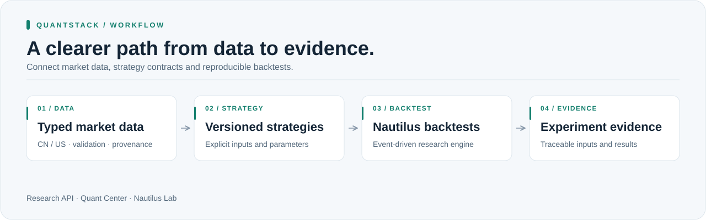
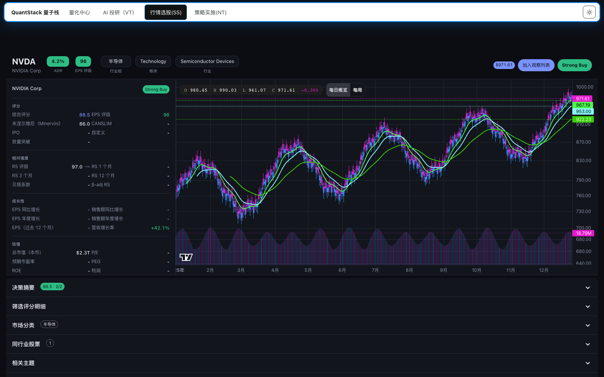
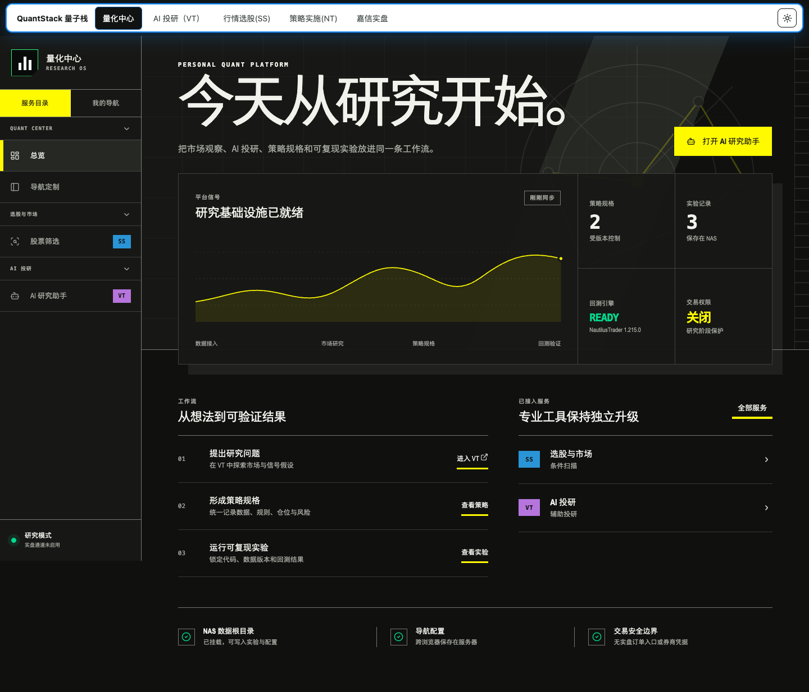
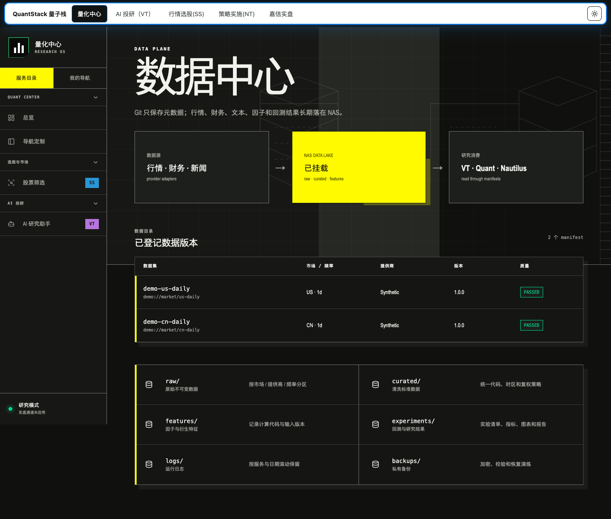
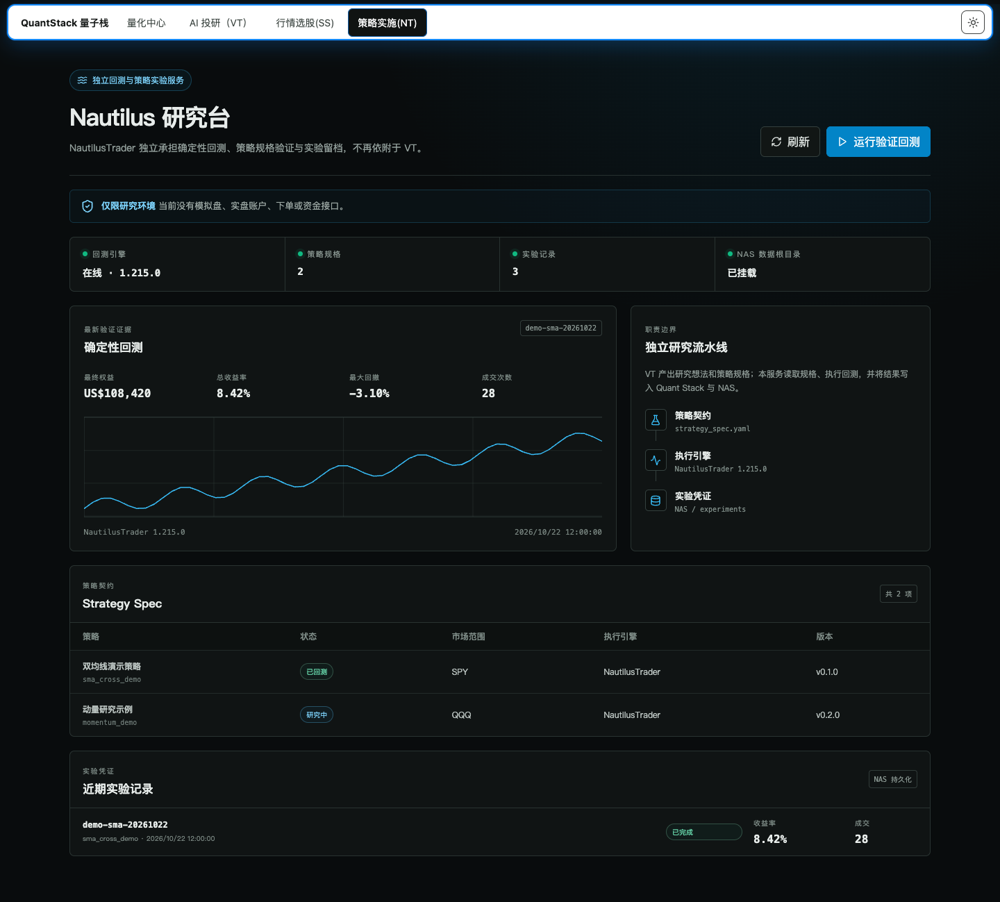

# QuantStack

**Market data you can trust. Research you can reproduce.**

QuantStack connects market-data contracts, strategy specifications and NautilusTrader
backtests in a self-hosted research workspace. Keep the inputs behind each experiment
traceable, compare results consistently, and move between data and research tools
without rebuilding the workflow for every strategy.

[Get started](#quick-start) · [Architecture](docs/ARCHITECTURE.md) · [Market-data API](docs/MARKET_DATA_BATCH_API.md) · [Configuration](docs/ENVIRONMENT.md)



## Interface preview

Captured from the actual web clients using isolated, synthetic API responses.
Names, dataset locations, counts, returns and the equity curve are illustrative;
they do not represent a real account, measured performance or live service health.



*Stock Screener integration preview: real chart/detail components with deterministic
synthetic OHLCV and demo metadata, plus QuantStack's shared navigation and Chinese
localization. This is an isolated interface illustration, not a production market
snapshot or a verified trade signal. Upstream: [Stock Screener](https://github.com/xang1234/stock-screener), Apache-2.0.*

<details>
<summary><strong>Quant Center overview</strong></summary>



</details>

<table>
  <tr><th>Versioned data catalog</th><th>Nautilus research workspace</th></tr>
  <tr>
    <td></td>
    <td></td>
  </tr>
</table>

## Built for systematic research

| Capability | What it gives you |
| --- | --- |
| **Consistent market data** | Typed CN/US data contracts, validation and provenance for a clearer research baseline. |
| **Reproducible experiments** | Versioned strategy inputs, NautilusTrader backtests and experiment bundles that preserve the context behind a result. |
| **A connected workspace** | A research API, Quant Center and Nautilus Lab, with optional Stock Screener and Vibe-Trading adapters. |

Designed for researchers and developers building their own quantitative research
infrastructure. The included workflow covers research and backtesting; it does not
provide live order execution. Brokerage examples use fictional data and
non-executable proposals.

## Quick start

Use Python 3.12 and [uv](https://docs.astral.sh/uv/).

```sh
git clone https://github.com/XingjianTian/QuantStack.git
cd QuantStack
uv sync --frozen --all-extras
uv run --no-env-file quant-stack validate-strategy strategies/examples/sma_cross/strategy_spec.yaml
```

To start the research API:

```sh
cp .env.example .env
chmod 600 .env
# Set an independent QUANT_API_KEY and local paths in .env.
make api
```

The web clients live in `apps/quant-center` and `apps/nautilus-lab`; optional upstream
applications are separate deployments. See [environment configuration](docs/ENVIRONMENT.md)
for service addresses, credentials, gateway setup and private runtime files.

## Explore

- [Strategy lifecycle](docs/STRATEGY_LIFECYCLE.md) — how research and evidence fit together.
- [Data management](docs/DATA_MANAGEMENT.md) — dataset boundaries and storage contracts.
- [Brokerage sample](docs/SCHWAB_READONLY_SAMPLE.md) — a fictional read-only research workflow.
- [Third-party notices](THIRD_PARTY_NOTICES.md) — upstream components and licenses.

<details>
<summary><strong>Development and verification</strong></summary>

Install Gitleaks 8.25+, configure a GitHub noreply email, then enable the local
privacy hook and run the offline suite:

```sh
make privacy-setup
uv run --no-env-file pytest
```

The public replay corpus is synthetic. Tests requiring private historical evidence
or optional external integrations may report explicit skips; these are not passing
integration checks. See [privacy checks](docs/PRIVACY.md) before contributing.

</details>

**License:** no project license has been selected. Third-party components retain
their respective licenses.
