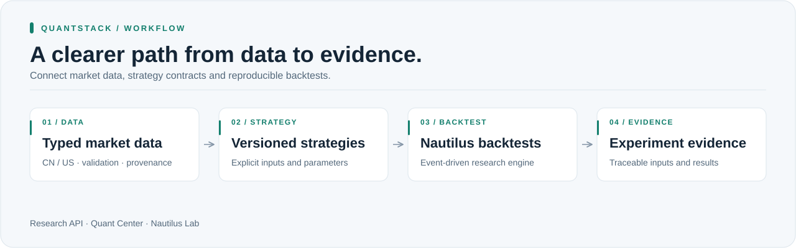
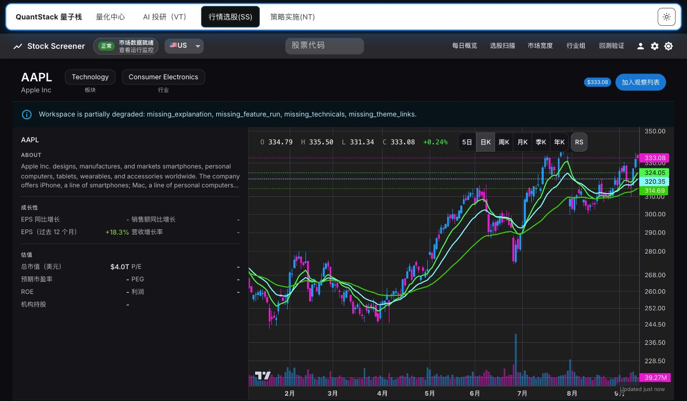
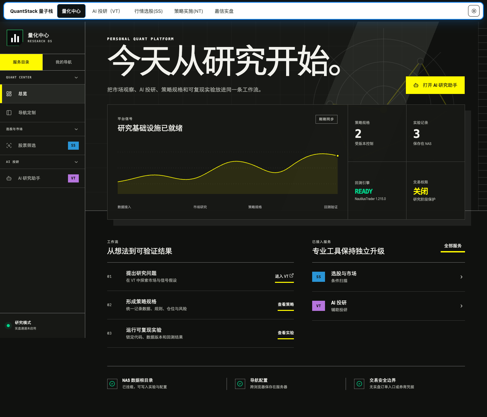
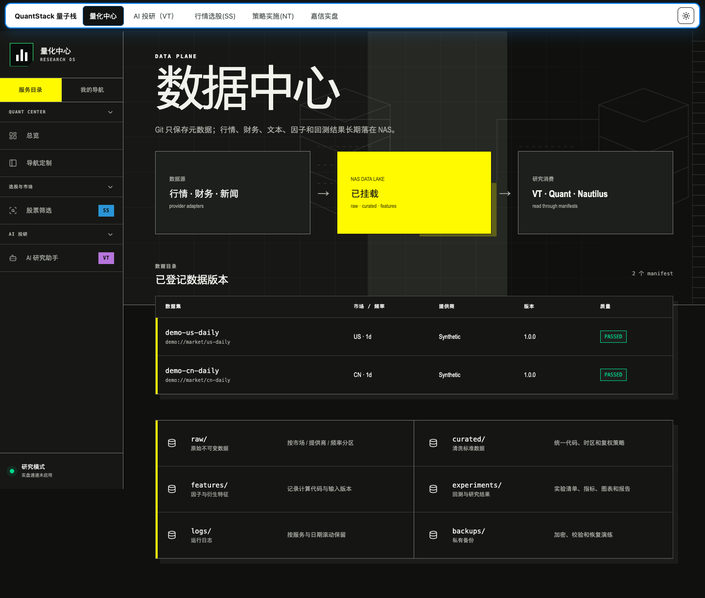
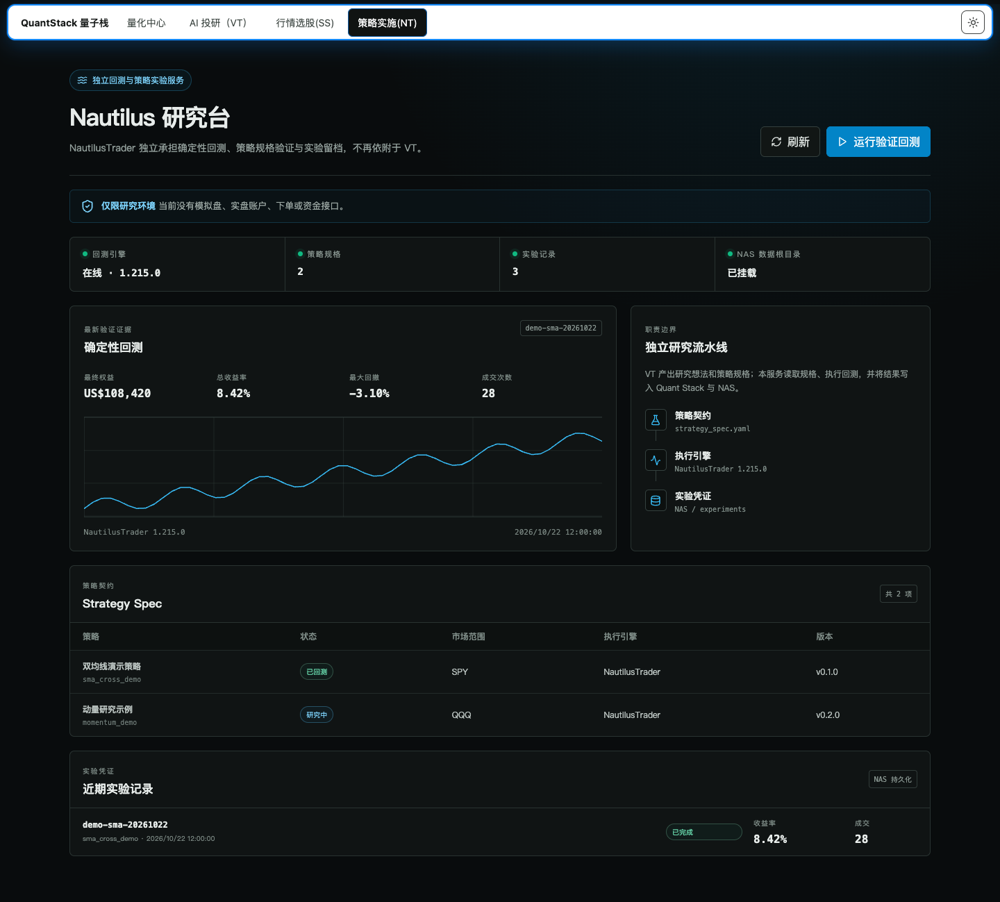

# QuantStack

[English (primary)](README.md) | **简体中文**

**可信的市场数据，可复现的研究。**

QuantStack 将市场数据合同、策略规范和 NautilusTrader 回测连接到自托管研究工作区。
让每次实验的输入有迹可循、一致地比较结果，并在数据与研究工具间切换，
无需为每个策略重新搭建流程。

[快速开始](#快速开始) · [架构](docs/ARCHITECTURE.md) · [市场数据 API](docs/MARKET_DATA_BATCH_API.md) · [配置](docs/ENVIRONMENT.md)



## 界面预览

下方 K 线截图于 2026 年 10 月 22 日直接截取自运行中的自托管 Stock Screener 部署。
画面展示应用实际的 AAPL 图表、均线和成交量，没有使用合成 OHLCV 或模拟 API 响应。
画面保留了可见的部分数据警告。



*实际应用截图，不代表市场数据实时性或交易信号。画面已排除浏览器外框和部署地址。
上游：[Stock Screener](https://github.com/xang1234/stock-screener)，Apache-2.0。*

下方 Quant Center、数据目录和 Nautilus Lab 图片使用隔离的合成 API 响应。
其中名称、数据集位置、计数、收益和权益曲线仅作说明，不是真实账户数据或实测表现。

<details>
<summary><strong>Quant Center 总览</strong></summary>



</details>

<table>
  <tr><th>版本化数据目录</th><th>Nautilus 研究工作区</th></tr>
  <tr>
    <td></td>
    <td></td>
  </tr>
</table>

## 面向系统化研究

| 能力 | 带来的价值 |
| --- | --- |
| **一致的市场数据** | 类型化的中国/美国市场数据合同、验证与来源记录，让研究基线更清晰。 |
| **可复现实验** | 版本化策略输入、NautilusTrader 回测和实验包，保留结果背后的上下文。 |
| **连接后的工作区** | 研究 API、Quant Center 和 Nautilus Lab，可选接入 Stock Screener 与 Vibe-Trading 适配器。 |

适合自行建设量化研究基础设施的研究者与开发者。
现有流程覆盖研究和回测，不提供实盘订单执行。券商示例使用虚构数据和不可执行的提案。

## 快速开始

使用 Python 3.12 和 [uv](https://docs.astral.sh/uv/)。

```sh
git clone https://github.com/XingjianTian/QuantStack.git
cd QuantStack
uv sync --frozen --all-extras
uv run --no-env-file quant-stack validate-strategy strategies/examples/sma_cross/strategy_spec.yaml
```

启动研究 API：

```sh
cp .env.example .env
chmod 600 .env
# 在 .env 中设置独立的 QUANT_API_KEY 和本地路径。
make api
```

Web 客户端位于 `apps/quant-center` 与 `apps/nautilus-lab`，可选上游应用单独部署。
服务地址、凭据、网关设置和私有运行文件见[环境配置](docs/ENVIRONMENT.md)。

## 继续了解

- [策略生命周期](docs/STRATEGY_LIFECYCLE.md)：研究和证据如何衔接。
- [数据管理](docs/DATA_MANAGEMENT.md)：数据集边界与存储合同。
- [券商示例](docs/SCHWAB_READONLY_SAMPLE.md)：虚构的只读研究流程。
- [第三方声明](THIRD_PARTY_NOTICES.md)：上游组件与许可证。

<details>
<summary><strong>开发与验证</strong></summary>

安装 Gitleaks 8.25+，配置 GitHub noreply 邮箱，再启用本地隐私钩子并运行离线测试：

```sh
make privacy-setup
uv run --no-env-file pytest
```

公开回放语料为合成数据。需要私有历史证据或可选外部集成的测试可能明确跳过；
这些跳过不代表集成检查通过。贡献前请阅读[隐私检查](docs/PRIVACY.md)。

</details>

**许可证：**项目尚未选择项目级许可证，第三方组件保留各自许可证。
